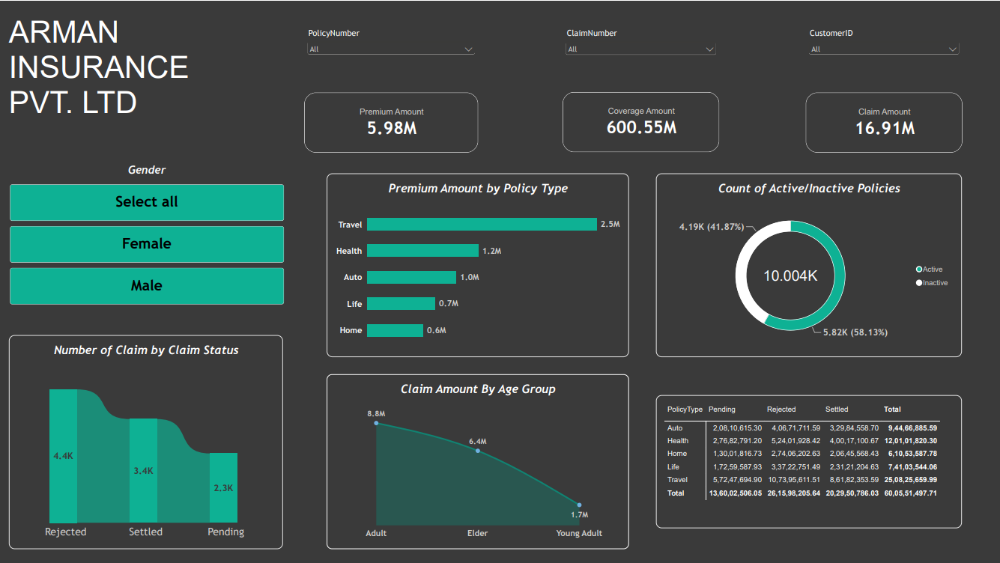
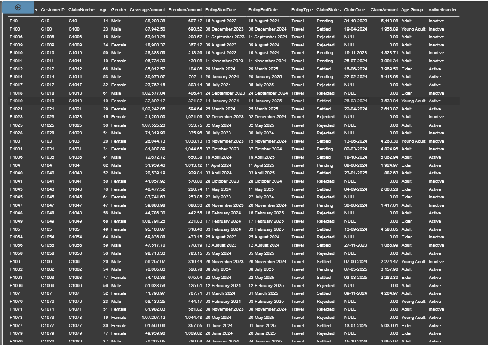

# Insurance Data Analytics Dashboard

An interactive **Power BI dashboard** designed to analyze insurance premiums, coverage amounts, claims, policy statuses, and customer demographics.

## 📊 Dashboard Preview

### 1. Insurance Analytics Dashboard

### 2. Insurance Dataset

## 🚀 Key Features

- **KPI Cards:** Total Premium Amount, Total Coverage Amount, and Total Claim Amount.
- **Interactive Slicers:** Filter data by Policy Number, Claim Number, Customer ID, and Gender.
- **Premium Analysis:** Analyze premiums across Travel, Health, Auto, Life, and Home policies.
- **Claim Status Analysis:** Compare Pending, Rejected, and Settled claims.
- **Policy Status Analysis:** Visualize Active and Inactive policies.
- **Age Group Analysis:** Compare claim amounts across Adult, Elder, and Young Adult groups.
- **Summary Table:** Compare claim status totals across policy types.

## 🛠️ Tools & Technologies

- **Microsoft Power BI Desktop** — Dashboard development and visualization.
- **CSV** — Source dataset.
- **Power Query** — Data preparation and transformation, where applicable.
- **SQL** - For data operation.

## 📁 Dataset Description

The project uses `InsuranceData.csv`, containing insurance policy, customer, and claim information.

| Column | Description |
|---|---|
| `PolicyNumber` | Policy identifier |
| `CustomerID` | Customer identifier |
| `Gender` | Customer gender |
| `Age` | Customer age |
| `PolicyType` | Insurance policy category |
| `PolicyStartDate` | Policy start date |
| `PolicyEndDate` | Policy end date |
| `PremiumAmount` | Insurance premium amount |
| `CoverageAmount` | Insurance coverage amount |
| `ClaimNumber` | Claim identifier |
| `ClaimDate` | Claim date |
| `ClaimAmount` | Claim amount |
| `ClaimStatus` | Pending, Rejected, or Settled status |

## 📈 Business Questions

1. Which policy type generates the highest premium amount?
2. How are claims distributed across different statuses?
3. What proportion of policies are Active versus Inactive?
4. How do claim amounts vary across age groups?
5. How do insurance metrics change when applying filters?

## ▶️ How to Run

1. Clone or download this repository.
2. Install [Power BI Desktop](https://www.microsoft.com/en-us/power-platform/products/power-bi/desktop).
3. Open `Insurance Dashboard.pbix`.
4. If prompted, update the data source path to `InsuranceData.csv`.
5. Refresh the data if necessary.
6. Use the slicers and visuals to explore the dashboard.
